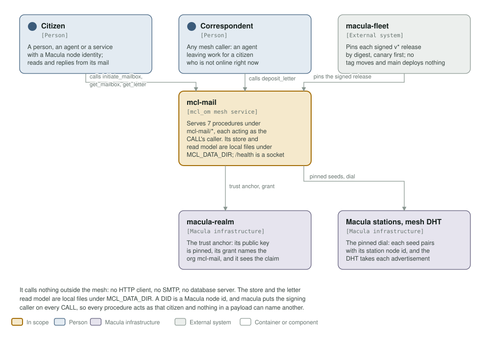
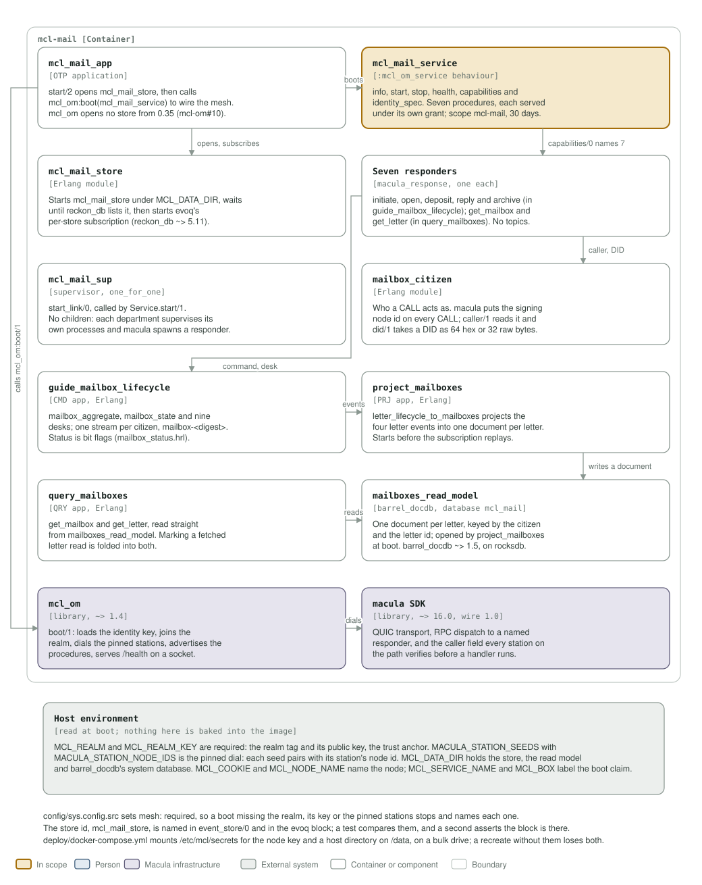

# mcl-mail architecture: C4 model

*This exists so a reader can see what mcl-mail talks to, and what it is made of,
without reading it.*

**Status: built and published, not yet pinned by the fleet.** The image is built in CI
and signed on a `v*` tag, but macula-fleet has no `mcl-mail-config.env` yet, so no box
runs it. The service boots, opens its own reckon-db store and the barrel_docdb letter
read model, and advertises seven procedures under `mcl-mail/*`.

## Level 1: system context

| Element | Kind | Role |
| --- | --- | --- |
| mcl-mail | In scope | Serves 7 procedures under `mcl-mail/*`, each acting as the CALL's caller. Its store and read model are local files under `MCL_DATA_DIR`, and `/health` is a Unix socket, `/run/mcl/health.sock` |
| Citizen | Person | A person, an agent or a service with a Macula node identity. Initiates and opens its mailbox, reads and replies from it, archives letters |
| Correspondent | Person | Any mesh caller: an agent leaving work for a citizen who is not online right now |
| macula-fleet | External system | Pins each signed `v*` release by digest, canary first. No tag moves and a push to main deploys nothing |
| macula-realm | Macula infrastructure | The trust anchor: its public key is pinned as `MCL_REALM_KEY`, its grant names the org `mcl-mail`, and its operator sees this node's boot claim on the Providers desk |
| Macula stations, mesh DHT | Macula infrastructure | The pinned dial: each seed in `MACULA_STATION_SEEDS` pairs with its node id in `MACULA_STATION_NODE_IDS`, and the DHT takes the capability advertisements |

The service calls nothing outside the mesh: no HTTP client, no SMTP, no database
server. The store and the letter read model are local files under `MCL_DATA_DIR`. A
DID is a Macula node id, and macula puts the signing caller on every CALL, so every
procedure acts as that citizen and nothing in a payload can name another mailbox.

## Level 2: containers and components

| Component | Technology | Responsibility |
| --- | --- | --- |
| `mcl_mail_app` | OTP application | `start/2` opens `mcl_mail_store`, then calls `mcl_om:boot(mcl_mail_service)`. mcl_om opens no store from 0.35 on (mcl-om#10) |
| `mcl_mail_service` | the `mcl_om_service` behaviour | `info/0`, `start/1`, `stop/1`, `health/0`, `capabilities/0`, `identity_spec/0`, plus `event_store/0`. Seven procedures, each served under its own realm grant; scope `mcl-mail`, 30 days, no actions and no resources |
| `mcl_mail_store` | Erlang module | Starts `mcl_mail_store` under `MCL_DATA_DIR`, waits until `reckon_db` lists it, then starts `evoq`'s per-store subscription, so projections see every event. `reckon_db ~> 5.11`, `evoq ~> 1.26`, `reckon_evoq ~> 2.7` |
| Seven responders | `macula_response`, one each | `initiate_mailbox`, `open_mailbox`, `deposit_letter`, `reply_to_letter` and `archive_letter` live in `guide_mailbox_lifecycle`; `get_mailbox` and `get_letter` live in `query_mailboxes`. The service publishes and subscribes to no topics |
| `mcl_mail_sup` | supervisor, `one_for_one` | `start_link/0`, called by `Service.start/1`. No children: each department supervises its own processes and macula spawns a responder per call |
| `mailbox_citizen` | Erlang module | Who a CALL acts as. macula puts the signing node id on every CALL; `caller/1` reads it and `did/1` takes a DID as 64 hex characters or the 32 raw bytes |
| `guide_mailbox_lifecycle` | CMD app, Erlang | `mailbox_aggregate`, `mailbox_state` and nine desks: initiate, open, close, archive and unarchive a mailbox; deposit, mark read, reply to and archive a letter. One stream per citizen, `mailbox-<128-bit digest>`. Status is bit flags in `mailbox_status.hrl` |
| `project_mailboxes` | PRJ app, Erlang | `letter_lifecycle_to_mailboxes` projects the four letter events into one document per letter. It starts before the subscription replays into it |
| `query_mailboxes` | QRY app, Erlang | `get_mailbox` and `get_letter`, read straight from `mailboxes_read_model`. Marking a fetched letter read is folded into both, so a mailbox is one round trip |
| `mailboxes_read_model` | barrel_docdb, database `mcl_mail` | One document per letter, keyed by the citizen and the letter id; opened by `project_mailboxes` at boot. `barrel_docdb ~> 1.5`, on the system librocksdb 11.1.2 |
| `mcl_om` | library, `~> 1.4` | `boot/1`: loads the identity key, joins the realm, dials the pinned stations, advertises the declared capabilities, serves `/health` on a Unix socket |
| macula SDK | library, `~> 16.0`, wire 1.0 | QUIC transport, RPC dispatch to a responder that answers by name, and the `caller` field every station on the path verifies before a handler runs |
| Host environment | read at boot | `MCL_REALM` and `MCL_REALM_KEY` (required), `MACULA_STATION_SEEDS` and `MACULA_STATION_NODE_IDS` (required), `MCL_DATA_DIR`, `MCL_NODE_NAME`, `MCL_NODE_HOST`, `MCL_COOKIE`, `MCL_SERVICE_NAME`, `MCL_BOX` |

`config/sys.config.src` sets `mesh: required`, so a boot missing the realm, its key or
the pinned stations stops and names each one instead of staying green, and it carries
the `evoq` block the subscription needs to start at all. The store id, `mcl_mail_store`,
is named in `event_store/0` and in that block; a test compares them and a second test
asserts the block is present. `deploy/docker-compose.yml` mounts `/etc/mcl/secrets` for
the node key and a host directory on `/data`, on a bulk drive: without the first a
recreate mints a new node id, without the second it loses the mail.

## Drawing them

`assets/c4-context.svg` and `assets/c4-components.svg` are generated by
`architecture/c4_diagrams.py` (`python3 architecture/c4_diagrams.py`), from the code
and never from this page: the callbacks and `capabilities/0` in
`apps/mcl_mail/src/mcl_mail_service.erl`, the boot order in `mcl_mail_app.erl`, the
store wiring in `mcl_mail_store.erl`, the four apps and their deps in `rebar.config`,
the org and realm settings in `config/sys.config.src`, the volumes in
`deploy/docker-compose.yml` and the health socket in the `Containerfile`.

Two rules for the files themselves, so they render everywhere they are read (GitHub,
an IDE, `rsvg-convert`): self-contained SVG, and literal colours in plain classes
plus a `prefers-color-scheme` dark block, never CSS custom properties, which
`rsvg-convert` renders black.

The check that keeps them here is the `c4-model` job in
`.github/workflows/build-push.yml`. It is red until both files exist and are shown,
and it stays red if either one goes missing.
